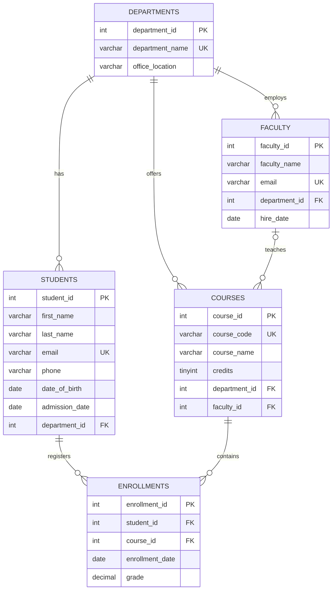

# Entity Relationship Diagram

## Relationship explanation
- `departments` to `students`: one-to-many.
- `departments` to `faculty`: one-to-many.
- `departments` to `courses`: one-to-many.
- `faculty` to `courses`: one-to-many; a course may have no assigned faculty yet.
- `students` to `courses`: many-to-many, resolved using `enrollments`.
- A unique constraint on `(student_id, course_id)` prevents a student from enrolling in the same course twice.
